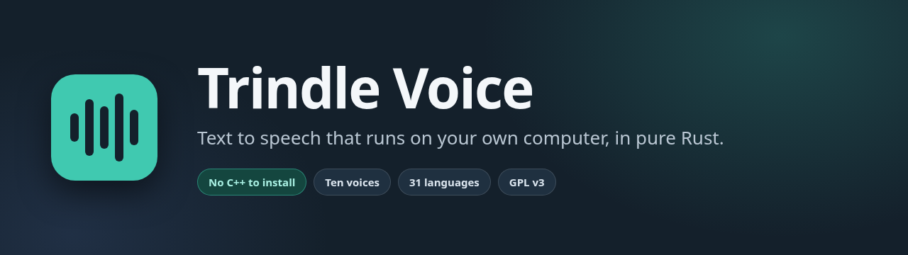
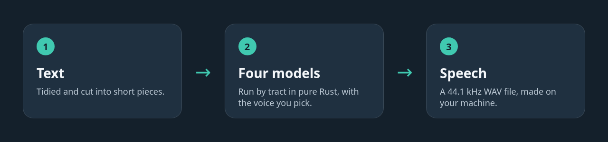

<p align="center"></p>

<p align="center">

[](CHANGELOG.md)
[](LICENSE)
[](Cargo.toml)
[](Cargo.toml)

</p>

Trindle Voice turns text into speech on your own computer. It is a maintained fork of
[Supertonic](https://github.com/supertone-oss-archive/supertonic) by Supertone Inc., whose
authors have archived it and no longer develop it.

It runs the Supertonic 2 voices (ten voices, M1 to M5 and F1 to F5, 31 languages plus a no-language tag) through
[tract](https://github.com/sonos/tract), a Rust ONNX engine. Nothing is sent anywhere, and
there is no ONNX Runtime and no C++ to install.

Choose it if you want speech made on your own machine, with nothing sent anywhere and
nothing to install beyond Rust. The same text and seed always give the same sound.

## How it works



## Credit

Supertonic is the work of Supertone Inc. Its name, copyright and original MIT licence are kept in
[NOTICE](NOTICE) and [LICENSE](LICENSE). The text tidying and chunking in `src/text.rs` is
ported from Supertonic's Rust example. The engine follows the same four-model pipeline.

## Quick start

The voice files are not in this repository. Download the Supertonic 2 files from
[Hugging Face](https://huggingface.co/Supertone/supertonic-2) into one folder and name them
like this:

```
supertonic-duration_predictor.onnx   supertonic-text_encoder.onnx
supertonic-vector_estimator.onnx     supertonic-vocoder.onnx
supertonic-unicode_indexer.json      supertonic-voice-M1.json  (and the other voices)
```

Check the downloads against [SHA256SUMS](SHA256SUMS) (`sha256sum -c SHA256SUMS` in that folder), then build and speak:

```bash
cargo build --release
./target/release/trindle-voice say --dir ~/voice-files --voice F1 --out hello.wav "Hello from Trindle."
```

Every option is in [Settings](#settings). An existing output file is replaced.

## What it does

- Ten voices (M1 to M5, F1 to F5) in 31 languages plus a no-language tag.
- Speed from 0.25 to 4 times, and a seed for repeatable sound.
- Long text is cut into pieces and joined in order, with a short pause between them.
- Writes a 44.1 kHz mono WAV file, replacing an existing file of the same name safely.
- Works as a command line tool or as a Rust library.
- Serves other programs, such as a screen reader, through a speech door (see below).

## Settings

| Option | Required | Default | What it does |
|---|---|---|---|
| `--dir` | Yes | none | Folder that holds the voice files |
| `--out` | Yes | none | WAV file to write |
| `--voice` | No | `M1` | M1 to M5 or F1 to F5 |
| `--lang` | No | `en` | Language code |
| `--speed` | No | `1.05` | 0.25 to 4 |
| `--seed` | No | random | A whole number; the same text and seed give the same sound |

## Speech server

`trindle-voice serve --dir DIR` opens a Unix socket at `$XDG_RUNTIME_DIR/trindle-voice/say.sock` and speaks what connected programs send. A message is a command word (`SAY`, `STOP`, `PAUSE`, `RESUME`, `CUE` or `PING`) followed by `key=value` pairs, on the first line or one per line after it, ended by a blank line. For example `SAY id=1 priority=normal text=Hello there` and a blank line. Text, if given, goes last on its line. Speech is English only and has four priorities (`urgent`, `focus`, `normal`, `background`); urgent cuts everything, focus cuts everything but urgent, and normal cuts background; background cuts nothing. The socket is open to you alone. Cues and speech play through `pw-play`, so PipeWire must be installed. The server leaves after a minute with nobody connected.

`trindle-voice render-phrases --dir DIR VOICE FILE-OF-LINES [OUT]` speaks every line of a file ahead of time into a `phrases-VOICE.bin` store beside the voice files, so those lines start at once. The voice may be given as `M5` or `supertonic-M5`; the store is named for the door's `supertonic-M5`.

Run by systemd, the server needs no start code: the package ships `systemd/trindle-voice.socket` and `trindle-voice.service` (user units). The socket is held by systemd, the server starts on the first connection and leaves after a minute idle, and the next connection starts it again. The package turns the socket on for every user by linking it into `sockets.target.wants` (in `/usr/lib/systemd/user`); with no package, run `systemctl --user enable --now trindle-voice.socket`. Voice files go in `/usr/share/trindle-voice` (about 253 MB, under the Open RAIL-M licence).

## Use as a library

```rust
let engine = trindle_voice::Voice::load(dir)?;
let style = trindle_voice::Voice::style(dir, "M1")?;
// text, language, voice style, speed, pause between chunks in seconds, cancel check
let mut samples = engine.speak("Hello.", "en", &style, 1.0, 0.3, None, &|| false)?;
trindle_voice::level(&mut samples);
```

`speak` returns 44.1 kHz mono samples and checks the cancel function between steps. Pass `Some(seed)` for repeatable sound. The `speech` module holds the server (queue, door, phrase store, player) and a `Reader` that keeps the model loaded and speaks a sentence at a time; `text::lead_pieces` cuts text for it.

## Where your data lives

Nowhere but your own disk. The voice files stay in the folder you chose, and the WAV file is
written where you say. Nothing is sent to any server.

## Security

The voice files are trusted input: check them against [SHA256SUMS](SHA256SUMS) first. How to
report a problem privately is in [SECURITY.md](SECURITY.md).

## Building it yourself

You need Rust 1.91 or newer, the least the tract crates will build with. Debian 13 ships Rust 1.85, so the deb is built with a newer toolchain from rustup.

```bash
cargo test
cargo build --release
```

## Licence

Code: GNU General Public License, version 3 or later ([LICENSE](LICENSE)). The original
Supertonic code is MIT, copyright Supertone Inc.; its notice is kept in [NOTICE](NOTICE), and
the changes are copyright Trindle contributors. The voice files are separate, by Supertone Inc. under
the BigScience Open RAIL-M License ([text](licences/supertonic-OpenRAIL-M.txt)); its use
restrictions (Attachment A in that file) apply to anyone who uses them.

## More

[docs/HELP.md](docs/HELP.md) (plain-words help), [CHANGELOG.md](CHANGELOG.md), [SECURITY.md](SECURITY.md), [CONTRIBUTING.md](CONTRIBUTING.md). Report bugs through the Trindle community at https://trindle.buildmorphic.com.

Comments are stripped from the published code to keep it lean.

## Disclaimer

Provided as is, without warranty.
